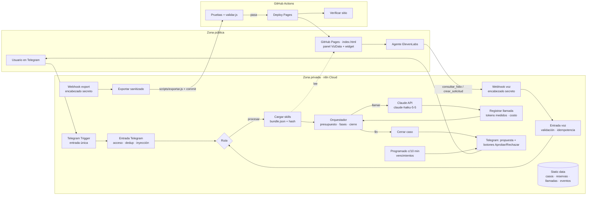

# Arquitectura

**Mismo `caso_id` en todo el recorrido:** folio creado en «Entrada Telegram» o «Entrada voz» → traza del orquestador y los cuatro agentes → `llamada_id` en costos → callback `ap|FOLIO|versión` → fila del panel publicado.

**Dónde corre cada componente**
| Componente | Dónde | Estado |
|---|---|---|
| Bot, orquestador, agentes, registro | n8n Cloud (workflow activo, URL de producción) | Privado |
| Modelo | API de Anthropic (`claude-haiku-5-5`) | Credencial en n8n |
| Voz | ElevenLabs (agente público con dominios permitidos) | Secreto del webhook en ElevenLabs |
| Panel, skills publicados | GitHub Pages | Público, solo datos ficticios agregados |
| Validación y publicación | GitHub Actions | Sin secretos |
